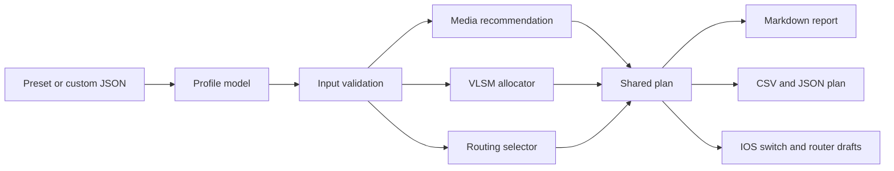

# Architecture and Data Flow

## System boundary

NetArchitect is a local Python CLI. Its inputs are JSON profile files; its outputs are Markdown, CSV, JSON, and Cisco IOS text. The application has no network clients, device credentials, cloud dependencies, or external runtime packages.

## Processing pipeline

All exports are rendered from the same `build_plan()` result. That is the main synchronization rule: address ranges are calculated once, then shared by the report, ACLs, SVIs, and device drafts.

## Modules

| Module | Responsibility |
|---|---|
| `models.py` | Immutable profile, link, subnet, and ACL data types |
| `validation.py` | CIDR, ID, VLAN, link, OSPF area, ACL, BGP, and VPN input checks |
| `media.py` | Distance boundaries, media choice, and explicit fiber-loss estimate |
| `vlsm.py` | Descending, aligned IPv4 allocation, gateway reservation, wildcard masks, overlap checks |
| `routing.py` | OSPF/eBGP recommendation and its rationale |
| `configgen.py` | Cisco IOS drafts driven by the shared allocations |
| `packetflow.py` | Cisco wildcard semantics and a deterministic one-ACL flow walk |
| `engine.py` | Shared orchestration plan and file exports |
| `cli.py` | Preset lookup, custom input, command parsing, and user-facing errors |

## Input schema

Each profile includes:

- Identity and context: `profile_id`, `name`, `description`, `endpoint_count`
- Address/routing inputs: `root_cidr`, `site_count`, `cloud_boundary`, `router_id`, optional `route_summary`
- Planning inputs: `switch_port_density` (used for a rough access-switch count) and `resiliency` (`standard`, `redundant`, or `dual_homed`)
- Optional objective: `target_latency_ms`
- `links`: distance, role, requested medium, and optical assumptions
- `subnets`: endpoint count, VLAN ID if applicable, purpose, OSPF area, and router interface for routed handoffs
- `acls`: source and destination segment names for explicit deny rules
- Optional cloud fields: local/peer ASNs, BGP transit name, VPN peer, and remote CIDR

The authoritative schema examples are the three files under `netarchitect/profiles/` and [examples/custom-profile.json](../examples/custom-profile.json).

## Error handling

Expected bad input is reported as a concise CLI error. `PhysicalDistanceViolationError` identifies a copper run above 100 m. `AddressSpaceExhaustedError` identifies the segment that cannot fit and asks for a larger root pool or smaller host request. Validation happens before exports are written.

## Configuration output model

The switch draft models a single logical Layer 3 core with SVI gateways and one sample access trunk. The router draft models one logical edge with the profile's routed handoffs. This is a presentation model for algorithmic defense, not a complete multi-device topology export. Site-specific production routers should receive only their own VLANs, interfaces, areas, and policy.

